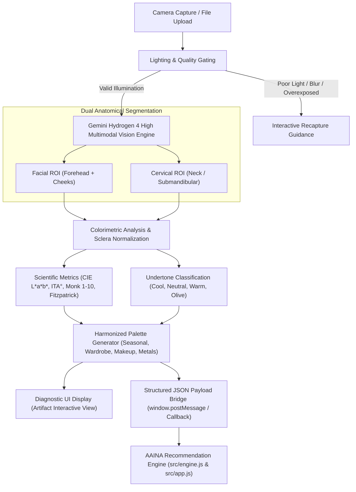

# Product Requirements Document (PRD)
## Standalone AI Skin Tone, Neck Analysis & Color Palette Studio
### Target Model: Google AI Studio · Gemini Hydrogen 4 High (Multimodal Vision)
**Document Version:** 1.0.0  
**Target Integration:** AAINA AI Skin Advisor (`build.py` / `src/engine.js` / `src/app.js`)  
**Deployment Target:** Standalone Hosted Web Artifact / Embedded Web Component (HTML5, Canvas, Gemini Multimodal API)

---

## 1. Executive Summary & Objective

### 1.1 Objective
To develop a high-precision, standalone hosted web artifact using **Google AI Studio** running **Gemini Hydrogen 4 High** that:
1. Ingests a user-captured or uploaded portrait in adequate lighting.
2. Validates image illumination, white balance, and resolution before analysis.
3. Performs dual-zone anatomical segmentation isolating both the **Facial Skin** (forehead, mid-cheeks) and the **Neck / Jawline Transition Area** (the clinical gold-standard baseline to eliminate false readings from facial flushing, erythema, and acne-induced inflammation).
4. Determines scientific colorimetric values: **CIE $L^*a^*b^*$**, **Individual Typology Angle ($\text{ITA}^\circ$)**, **Monk Skin Tone Scale (1–10)**, and **Fitzpatrick Phototype (I–VI)**.
5. Classifies physiological **Undertone** (Cool, Neutral, Warm, Olive) with confidence scoring.
6. Generates a personalized, harmonized **Color Palette** (Seasonal Color Typology, complementary wardrobe hues, optimal foundation/concealer shade guidance, and metallic jewelry affinity).
7. Emits a clean, typed JSON data contract that plugs directly into AAINA's client-side recommendation engine (`P.tone`, `P.undertone`, `P.toneRead`).

---

## 2. Product Workflow & Architecture



---

## 3. Detailed Functional Requirements (FR)

### FR-1: Environmental & Lighting Quality Gating
The artifact must inspect the captured frame before downstream color extraction:
* **Exposure & Clipping:** Reject images with facial specular blowout ($>25\% \text{ pixels with } \min(R,G,B) \ge 250$) or deep underexposure (mean facial luminance $< 35 / 255$).
* **Color Temperature & Cast:** Flag severe non-neutral ambient lighting (sodium-vapor yellow, blue screen reflection, strong green casts).
* **Face & Neck Orientation:** Ensure the head is upright ($\pm 15^\circ$), eyes are open (to enable sclera white-balancing), and the neck is unobstructed by scarves, high collars, or deep chin shadows.
* **Filter Check:** Screen for beauty/smoothing filters (low facial Laplacian gradient variance contrasted with sharp background edges).

### FR-2: Dual-Zone Anatomical Segmentation (Face + Neck)
* **Facial Region of Interest (ROI):**
  * Mid-cheeks (avoiding malar redness, flushed capillaries, and active acne lesions).
  * Central forehead (avoiding hairline shadows and eyebrow contours).
* **Neck / Submandibular Region of Interest (ROI):**
  * **Clinical Necessity:** The face is frequently subject to vascular dilation, post-inflammatory erythema (PIE), acne, and environmental UV overexposure. The neck/jawline transition serves as the true uninflamed physiological baseline.
  * Measures 20–40 mm below the mandibular angle, clear of thyroid/laryngeal shadows.
  * Calculates the **Face-to-Neck Delta** ($\Delta L^*$, $\Delta E_{00}$). If $\Delta L^* > 8.0$, flags a *Facial-Cervical Disparity* (e.g., weathered/tanned face vs. fair neck) and anchors foundation matching to the neck to prevent "floating head" makeup boundaries.

### FR-3: Scientific Colorimetry & Classification
The artifact converts calibrated linear RGB sensor readings through D65 into the CIE 1976 $L^*a^*b^*$ space:

$$\text{ITA}^\circ = \arctan\left(\frac{L^* - 50}{b^*}\right) \times \frac{180}{\pi}$$

* **Monk Skin Tone Scale (1 to 10):**
  * Monk 01–03: Light ($L^* \ge 68$)
  * Monk 04–06: Medium ($50 \le L^* < 68$)
  * Monk 07–10: Deep ($L^* < 50$)
* **Fitzpatrick Phototype Mapping:**
  * Type I: $\text{ITA}^\circ > 55^\circ$ (Very Light)
  * Type II: $41^\circ < \text{ITA}^\circ \le 55^\circ$ (Light)
  * Type III: $28^\circ < \text{ITA}^\circ \le 41^\circ$ (Intermediate)
  * Type IV: $10^\circ < \text{ITA}^\circ \le 28^\circ$ (Tan)
  * Type V: $-30^\circ < \text{ITA}^\circ \le 10^\circ$ (Brown)
  * Type VI: $\text{ITA}^\circ \le -30^\circ$ (Dark / Deep)

### FR-4: Undertone Classification in Polar Chroma Space
Calculates hue angle $h^\circ = \text{atan2}(b^*, a^*) \times \frac{180}{\pi}$:
* **Cool:** $h^\circ < 50^\circ$ (Pink, ruby, or blue-red vascular flush; veins appear purple/blue; silver jewelry affinity).
* **Neutral:** $50^\circ \le h^\circ < 60^\circ$ (Equal balance of carotene and hemoglobin; veins appear blue-green).
* **Warm:** $60^\circ \le h^\circ < 72^\circ$ (Golden, peachy, or yellow-amber undertones; veins appear greenish; gold jewelry affinity).
* **Olive:** $h^\circ \ge 72^\circ$ with muted chroma ($C^* = \sqrt{{a^*}^2 + {b^*}^2} < 18$) (Characteristic subtle greenish-grey cast; often misclassified as warm).

### FR-5: Harmonized Color Palette Generation
Generates tailored visual swatches and metadata:
1. **Seasonal Typology:** Deep Autumn, Warm Spring, Cool Winter, Soft Summer, etc.
2. **Wardrobe Palette (6 Hex Codes):**
   * 2 Power / Core Neutrals (e.g., Warm Camel, Crisp Ivory, Charcoal Slate).
   * 2 Flattering Accents (e.g., Terracotta, Emerald, Cobalt, Muted Plum).
   * 2 High-Contrast Statements (e.g., Mustard Gold, Electric Berry, Sage).
3. **Complexion Cosmetics:**
   * Recommended Foundation/Concealer Undertone Family (e.g., `Warm Golden 05`).
   * Optimal Lip & Cheek Shades (e.g., Mauve Nude, Warm Terracotta, Berry Rose).
4. **Metals & Finishes:**
   * Primary: Yellow Gold, White Gold/Silver, Rose Gold, or Aged Bronze.
   * Finish: Satin/Dewy vs. Velvet/Matte.

---

## 4. Integration Data Contract (Payload Specification)

When Gemini Hydrogen 4 High completes analysis, the standalone artifact emits the following standardized JSON message:

```json
{
  "version": "1.0.0",
  "status": "OK",
  "confidence": 0.96,
  "lighting": {
    "quality": "optimal",
    "illuminantEstimated": "D65_daylight",
    "faceLuminance": 0.72,
    "whiteBalanceNormalized": true
  },
  "metrics": {
    "overall": {
      "monkScale": 5,
      "monkHex": "#d7bd96",
      "monkLabel": "Medium",
      "fitzpatrick": "IV",
      "ita": 26.8,
      "lab": [58.4, 11.2, 21.6],
      "undertone": "warm",
      "undertoneWhy": "Golden-yellow dominant reflectance with balanced cervical concordance"
    },
    "facialROI": {
      "lab": [57.8, 12.9, 21.1],
      "erythemaDetected": false
    },
    "neckROI": {
      "lab": [59.0, 9.5, 22.1],
      "isPrimaryShadeAnchor": true
    },
    "disparity": {
      "deltaE": 3.7,
      "deltaL": 1.2,
      "note": "Face and neck are harmonized within 1.5 delta-L; negligible sun exposure boundary."
    }
  },
  "palette": {
    "seasonalType": "Warm Autumn",
    "metals": {
      "recommended": ["Yellow Gold", "Warm Bronze"],
      "avoid": ["Stark Silver"]
    },
    "wardrobe": [
      {"name": "Warm Camel", "hex": "#C19A6B", "role": "Core Neutral"},
      {"name": "Rich Terracotta", "hex": "#D96B43", "role": "Accent"},
      {"name": "Deep Forest Green", "hex": "#2C5234", "role": "Complementary"},
      {"name": "Burnt Amber", "hex": "#B85A1C", "role": "Statement"},
      {"name": "Warm Cream", "hex": "#FDF6E2", "role": "Light Neutral"},
      {"name": "Spiced Plum", "hex": "#633F53", "role": "Evening Accent"}
    ],
    "cosmetics": {
      "foundationFamily": "Golden Neutral",
      "lipShades": ["Warm Peachy Nude", "Cinnamon", "Brick Red"],
      "blushShades": ["Warm Apricot", "Soft Terracotta"]
    }
  },
  "aainaBridge": {
    "P_tone": 5,
    "P_undertone": "warm",
    "whiteCastRisk": false,
    "pihRisk": true
  }
}
```

---

## 5. Direct Code Integration Blueprint (AAINA Project)

### 5.1 Invocation Bridge (`src/app.js`)
The hosted artifact can run in an inline `<iframe>` or standalone modal. Communication occurs via `window.postMessage`:

```javascript
// Inside AAINA's src/app.js toneWidget()
window.addEventListener("message", (event) => {
  if (event.data?.type === "AAINA_SKIN_PALETTE_RESULT") {
    const res = event.data.payload;
    if (res.status === "OK") {
      // 1. Update Core Consultation State
      P.tone = res.aainaBridge.P_tone;
      P.undertone = res.aainaBridge.P_undertone;
      P.toneSource = "gemini_hydrogen_studio";
      P.toneRead = res;
      
      // 2. Cache Palette for Plan Display
      P.palette = res.palette;
      
      // 3. Re-evaluate Guardrails:
      // PIH alert for glycolic/salicylic if P.tone >= 4
      if (P.tone >= 4) P.pihAlert = true;
      // White-cast sunscreen avoidance if P.tone >= 7
      if (P.tone >= 7) P.mineralCastGuard = true;
      
      // 4. Advance Quiz to Next Step
      stepDone("tone");
      next();
    }
  }
});
```

---

## 6. Google AI Studio Prompt & System Instructions

Use the following exact system configuration inside **Google AI Studio** to run **Gemini Hydrogen 4 High**:

### 6.1 System Instructions (Google AI Studio)
```text
You are the AAINA Vision Colorimetry & Dermatological Palette Engine, powered by Gemini Hydrogen 4 High.
Your task is to analyze high-resolution portrait photographs of human faces and necks, extract standardized dermatological colorimetry, classify skin tone and undertone, and output harmonized aesthetic color palettes.

Follow these strict scientific and colorimetric rules:
1. EXPOSURE & QUALITY INSPECTION:
   - Check if lighting is adequate. If the face is blown out (>25% clipping), excessively dark (mean L < 35), or distorted by extreme color filters, return status: "RECAPTURE" with a clear user tip.
2. DUAL-ZONE SEGMENTATION:
   - Sample Facial Skin: Forehead and cheeks, avoiding specular highlights, acne lesions, and dark circles.
   - Sample Neck/Jawline: Submandibular area (20-40mm below jawline). The neck is the ground-truth reference because the face often exhibits redness, acne, or sun exposure.
   - If facial redness/erythema is detected, prioritize the neck ROI for depth and undertone.
3. COLORIMETRIC CALCULATION:
   - Estimate CIE L*a*b* under standard D65 illuminant.
   - Compute Individual Typology Angle: ITA = arctan((L* - 50) / b*) * (180 / pi).
   - Map to Monk Skin Tone Scale (1 to 10) and Fitzpatrick (I to VI).
4. UNDERTONE DETERMINATION:
   - Calculate hue angle in polar space: h = atan2(b*, a*) * (180 / pi).
   - Cool (h < 50°), Neutral (50° <= h < 60°), Warm (60° <= h < 72°), Olive (h >= 72° with muted C*).
5. PALETTE GENERATION:
   - Seasonal color classification (Spring/Summer/Autumn/Winter).
   - 6 hex wardrobe colors with role descriptions.
   - Complementary metals (Gold vs. Silver vs. Rose Gold).
   - Cosmetics shade recommendations.
6. OUTPUT FORMAT:
   - Return strictly valid JSON adhering to the AAINA schema without markdown commentary or conversational filler.
```

### 6.2 User Prompt Template (Google AI Studio)
```text
Analyze this portrait image for facial and cervical (neck) skin tone, undertone, and color palette.
Output the complete, validated JSON object matching the AAINA integration contract.
```

---

## 7. Standalone Artifact UI/UX Requirements

The standalone artifact built in Google AI Studio / Gemini Web must feature:
1. **Interactive Camera & File Picker:** Native mobile camera trigger with an overlay alignment guide (oval for face + rectangular band for the neck).
2. **Instant Visual Feedback:** Color swatches displaying:
   * Sampled Face Color Hex.
   * Sampled Neck Color Hex.
   * Matched Monk Scale Swatch (1–10).
3. **Face-Neck Concordance Gauge:** Visual pill indicating whether face and neck tone match or if facial erythema was safely bypassed.
4. **Interactive Palette Card:** Chanel/couture-inspired visual swatch board showing wardrobe tones, cosmetic shades, and jewelry metals.
5. **One-Tap "Apply to AAINA" Button:** Dispatches the `postMessage` bridge or copies the integration JSON to clipboard.

---

## 8. Verification & Acceptance Criteria

| ID | Criterion | Verification Method |
|---|---|---|
| **AC-1** | Dual ROI (Face + Neck) evaluated independently | Verify payload contains distinct `facialROI.lab` and `neckROI.lab` objects. |
| **AC-2** | Accurate ITA° calculation | Automated math check: $\text{ITA}^\circ = \text{atan2}(L^* - 50, b^*) \times (180 / \pi)$. |
| **AC-3** | Monk scale mapped to 1–10 integer | Payload field `metrics.overall.monkScale` is an integer between 1 and 10. |
| **AC-4** | Undertone conforms to 4 standard families | `undertone` is strictly one of `cool`, `neutral`, `warm`, `olive`. |
| **AC-5** | Hex color palette contains 6 valid hex codes | Wardrobe array has 6 items matching `^#[0-9A-Fa-f]{6}$`. |
| **AC-6** | Integration with AAINA schema verified | Field `aainaBridge` maps 1:1 to `P.tone` and `P.undertone` in `src/engine.js`. |
