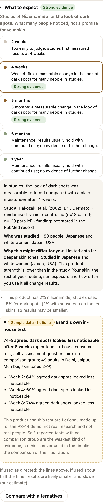
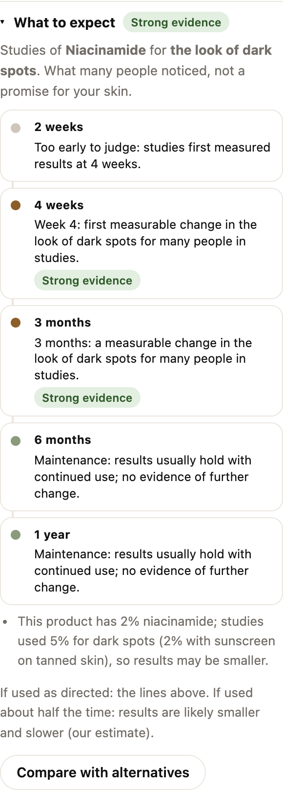
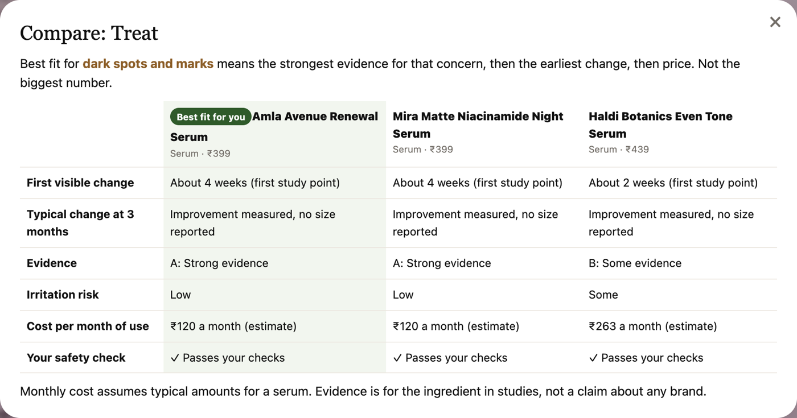
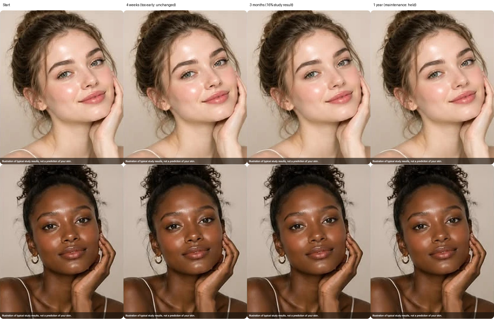

# Results timeline: evidence and coverage (2026-11-18)

The Results timeline shows what **studies of each key ingredient** measured at 2 weeks, 4 weeks, 3 months, 6 months and 1 year. It never predicts a person's skin and never invents a number. Source of truth: `data/evidence/actives_timeline.json`, checked by `python3 tools/check_evidence.py`.

## How it decides
- **One active drives the line**: the best-evidenced active for the shopper's concern (grade, then how many measured numbers). Other relevant actives are listed as "may also help"; effects are never added together.
- **Numbers only where a study measured them**, as reported in the PubMed abstract. Many abstracts report "significantly better than a plain cream" without a size: those points say so and show **no number**.
- **Scale down, never up**: if the product doesn't state its strength, or it's below the studied strength, the low end of the study range is used, or no number at all.
- **Past the last study point**: "Maintenance: results usually hold with continued use; no evidence of further change", or "not studied". A result measured between stops (for example at 22 weeks) appears at the next stop, labelled with its real week.
- **Studies in people with a diagnosed skin condition** (the topical tranexamic acid trial) are shown as context only and never drive the numbers.
- **Rinse-off products** (cleansers, masks) get no timeline: the studies tested leave-on products.
- **Adherence**: a second line, "If used about half the time", halves a measured change and says it's our estimate.
- **Wording**: every string passes a lint for promises and medical terms (`you will`, `guaranteed`, `cures`, `removes`, `lightens/brightens`, condition names…), in both `tools/check_evidence.py` and `tests/timeline_unit_test.js`.

## Coverage: skincare products by best evidence grade
A = randomised, vehicle-controlled, n≥50 · B = smaller or less controlled RCT · C = open-label, uncontrolled, review of low-quality trials, or a blend · D = no timeline ("not enough evidence").

```
Category          A    B    C    D   total
Cleanser           0    0    0   80     80
Exfoliant         36    0    4    0     40
Eye cream         20    0    0    5     25
Face mask          0    0    0   40     40
Face oil           0    5    0   15     20
Lip care           0    0    0   22     22
Moisturiser       60    0    7   43    110
Serum             50   43   18   14    125
Spot treatment    12    3    5    5     25
Sunscreen         85    0    0    0     85
Toner             23    0    0   19     42
All skincare     286   51   34  243    614
```

**Products with no timeline (grade D) and why:** {'rinse-off product (studies were leave-on)': 120, 'no key actives listed': 58, 'only actives without suitable evidence': 65}

Actives with no suitable peer-reviewed study (no timeline shown): **Licorice, Centella, Zinc PCA, Caffeine, Saffron, Turmeric**.

## Evidence by active

| Active | Concern | Grade | Study points (weeks) | Measured sizes | Deeper skin tones |
|---|---|---|---|---|---|
| Niacinamide | oiliness and shine | A | 2, 4, 6 | improvement reported, no size | limited data for deeper skin tones |
| Niacinamide | appearance of dark spots | A | 4, 12 | improvement reported, no size | limited data for deeper skin tones |
| Niacinamide | fine lines | A | 12 | improvement reported, no size | limited data for deeper skin tones |
| Niacinamide | visible redness and blotchiness | A | 12 | improvement reported, no size | limited data for deeper skin tones |
| Tranexamic acid | appearance of dark spots | B | 2, 8, 12 | improvement reported, no size | limited data for deeper skin tones |
| Alpha arbutin | appearance of dark spots | C | 13 | 13w: 16.3 % lower melanin in dark spots | studied in Indian skin (types III–IV); no data for deeper tones |
| Vitamin C | fine lines and rough texture | B | 12 | 12w: 73.7 % of participants improving more on the vitamin C side | no data for deeper skin tones |
| Retinol | fine lines | A | 4, 8, 12, 52 | 52w: 44 % improvement from baseline | skin types not reported in the abstracts; assume limited data for deeper tones |
| Retinol | appearance of dark spots | A | 4, 12, 52 | 52w: 84 % improvement from baseline | skin types not reported in the abstracts; assume limited data for deeper tones |
| Bakuchiol | fine lines | B | 12 | improvement reported, no size | limited data for deeper skin tones |
| Glycolic acid | dullness and rough texture | A | 12, 22 | 22w: 76 % of participants improving ≥1 grade (40% with plain cream) | limited data for deeper skin tones |
| Lactic acid | dullness and rough texture | A | 22 | 22w: 71 % of participants improving ≥1 grade (40% with plain cream) | limited data for deeper skin tones |
| Salicylic acid | blemishes and clogged pores | C | 12 | improvement reported, no size | limited data for deeper skin tones |
| Azelaic acid | appearance of dark spots | B | 24 | improvement reported, no size | studied in darker skin types IV–VI |
| Azelaic acid | blemishes | C | 12 | improvement reported, no size | limited data for deeper skin tones |
| Tea tree oil | blemishes | A | 6.4 | 6.4w: 3.55 times the improvement seen with a plain gel | limited data for deeper skin tones |
| Hyaluronic acid | dryness | A | 4, 8 | improvement reported, no size | limited data for deeper skin tones |
| Ceramides | dryness | C | 2 | improvement reported, no size | limited data for deeper skin tones |
| Peptides | fine lines | A | 12 | improvement reported, no size | limited data for deeper skin tones |
| Sunscreen | protection from visible sun damage | A | 12, 52, 234 | 52w: 40–52 % improvement from baseline; 234w: 24 % less skin ageing than occasional use | limited data for deeper skin tones |

## Evidence gaps, especially for deeper skin tones
- Almost every study was in **white, Japanese, Korean or Brazilian** participants. Only two cover deeper or Indian skin: **azelaic acid 20%** (skin types IV–VI, dark spots, no size reported) and the **alpha-arbutin** study in **Indian women, skin types III–IV** (open-label, blended with another active and sunscreen).
- **No timeline** for licorice, centella, zinc PCA, caffeine, saffron or turmeric: no peer-reviewed controlled study found for the ingredient alone.
- **Salicylic acid** and **azelaic acid** for blemishes rest on a Cochrane review that rates the evidence low quality, with no reliable size of change: grade C, no numbers.
- **Ceramides**: only a blend with urea, tested on forearms: grade C.
- **Peptides**: evidence is for one specific peptide (palmitoyl pentapeptide); products rarely state which peptide they use.
- **Vitamin C**: one 19-person split-face study in skin types I–III.
- **No study** in this table measures "if stopped"; every entry says "not studied".
- The safety guide says the advisor should repeat only claims brands make. The timeline describes **ingredient studies**, labelled as such, not claims about any product.

## Sample product studies (fictional)
The catalogue's products and brands are fictional, so they have no real product studies. `tools/make_sample_studies.py` generates one **fictional in-house consumer test per skincare product** (614): sample size, test weeks, and the share of people who agreed with a statement like "dark spots looked less noticeable". The output is `data/evidence/sample_product_studies.json`.
- **Clearly marked:** they always show with a **"Sample data · fictional"** badge, inside a separate dashed box. The box says the product and test are made up, not real research and not real people.
- **No fake citations:** no PubMed ID, DOI, journal or author.
- **Never mixed with real evidence:** they never change the real timeline's grade, numbers, comparison ranking or illustration. The unit tests check this for every product.
- **Product only, never ingredients:** they describe the fictional *product*. Real ingredients keep only their real evidence; no made-up results are attached to an ingredient (licorice, centella and the others still say "not enough evidence").

## Screenshots
- What to expect on a product card: 
- On a phone: 
- Compare three products (best fit = strongest evidence for *your* concern, then earliest change, then price): 
- Illustration at start / 4 weeks / 3 months / 1 year on a light and a deep model face (an alpha-arbutin 2% product: nothing changes before the first study point, a 16% change at 3 months, held flat at 1 year; only spot contrast in the face area changes, never overall tone or lightness): 

## References
- Stiller et al. (1996). Topical 8% glycolic acid and 8% L-lactic acid creams for the treatment of photodamaged skin. A double-blind vehicle-controlled clinical trial. *Arch Dermatol*. PMID [8651713](https://pubmed.ncbi.nlm.nih.gov/8651713/). Design: randomised, double-blind, vehicle-controlled. Funding: not stated in the PubMed record.
- Thibault et al. (1998). A double-blind randomized clinical trial on the effectiveness of a daily glycolic acid 5% formulation in the treatment of photoaging. *Dermatol Surg*. PMID [9598014](https://pubmed.ncbi.nlm.nih.gov/9598014/) · doi 10.1111/j.1524-4725.1998.tb04209.x. Design: randomised, double-blind, placebo-controlled. Funding: not stated in the PubMed record.
- Lowe et al. (1998). Azelaic acid 20% cream in the treatment of facial hyperpigmentation in darker-skinned patients. *Clin Ther*. PMID [9829446](https://pubmed.ncbi.nlm.nih.gov/9829446/) · doi 10.1016/s0149-2918(98)80076-3. Design: randomised, double-masked, vehicle-controlled. Funding: not stated in the PubMed record.
- Traikovich (1999). Use of topical ascorbic acid and its effects on photodamaged skin topography. *Arch Otolaryngol Head Neck Surg*. PMID [10522500](https://pubmed.ncbi.nlm.nih.gov/10522500/) · doi 10.1001/archotol.125.10.1091. Design: randomised, double-blind, split-face, vehicle-controlled. Funding: not stated in the PubMed record.
- Hakozaki et al. (2002). The effect of niacinamide on reducing cutaneous pigmentation and suppression of melanosome transfer. *Br J Dermatol*. PMID [12100180](https://pubmed.ncbi.nlm.nih.gov/12100180/) · doi 10.1046/j.1365-2133.2002.04834.x. Design: randomised, vehicle-controlled (n=18 paired; n=120 parallel). Funding: not stated in the PubMed record.
- Bissett et al. (2005). Niacinamide: A B vitamin that improves aging facial skin appearance. *Dermatol Surg*. PMID [16029679](https://pubmed.ncbi.nlm.nih.gov/16029679/) · doi 10.1111/j.1524-4725.2005.31732. Design: randomised, double-blind, split-face, vehicle-controlled. Funding: not stated in the PubMed record.
- Robinson et al. (2005). Topical palmitoyl pentapeptide provides improvement in photoaged human facial skin. *Int J Cosmet Sci*. PMID [18492182](https://pubmed.ncbi.nlm.nih.gov/18492182/) · doi 10.1111/j.1467-2494.2005.00261.x. Design: randomised, double-blind, split-face, placebo-controlled. Funding: not stated in the PubMed record.
- Draelos et al. (2006). The effect of 2% niacinamide on facial sebum production. *J Cosmet Laser Ther*. PMID [16766489](https://pubmed.ncbi.nlm.nih.gov/16766489/) · doi 10.1080/14764170600717704. Design: randomised, placebo-controlled (n=100) and split-face (n=30). Funding: not stated in the PubMed record.
- Enshaieh et al. (2007). The efficacy of 5% topical tea tree oil gel in mild to moderate acne vulgaris: a randomized, double-blind placebo-controlled study. *Indian J Dermatol Venereol Leprol*. PMID [17314442](https://pubmed.ncbi.nlm.nih.gov/17314442/) · doi 10.4103/0378-6323.30646. Design: randomised, double-blind, placebo-controlled. Funding: not stated in the PubMed record.
- Pavicic et al. (2011). Efficacy of cream-based novel formulations of hyaluronic acid of different molecular weights in anti-wrinkle treatment. *J Drugs Dermatol*. PMID [22052267](https://pubmed.ncbi.nlm.nih.gov/22052267/). Design: randomised, split-face, vehicle-controlled. Funding: not stated in the PubMed record.
- Hughes et al. (2013). Sunscreen and prevention of skin aging: a randomized trial. *Ann Intern Med*. PMID [23732711](https://pubmed.ncbi.nlm.nih.gov/23732711/) · doi 10.7326/0003-4819-158-11-201306040-00002. Design: randomised, community-based. Funding: National Health and Medical Research Council of Australia (public).
- Lee et al. (2014). Reduction in facial hyperpigmentation after treatment with a combination of topical niacinamide and tranexamic acid: a randomized, double-blind, vehicle-controlled trial. *Skin Res Technol*. PMID [24033822](https://pubmed.ncbi.nlm.nih.gov/24033822/) · doi 10.1111/srt.12107. Design: randomised, double-blind, vehicle-controlled. Funding: not stated in the PubMed record.
- Randhawa et al. (2015). One-year topical stabilized retinol treatment improves photodamaged skin in a double-blind, vehicle-controlled trial. *J Drugs Dermatol*. PMID [25738849](https://pubmed.ncbi.nlm.nih.gov/25738849/). Design: double-blind, vehicle-controlled. Funding: not stated in the PubMed record.
- Randhawa et al. (2016). Daily Use of a Facial Broad Spectrum Sunscreen Over One-Year Significantly Improves Clinical Evaluation of Photoaging. *Dermatol Surg*. PMID [27749441](https://pubmed.ncbi.nlm.nih.gov/27749441/) · doi 10.1097/DSS.0000000000000879. Design: open-label, single-arm, no control. Funding: not stated in the PubMed record.
- Desai et al. (2019). Effect of a Tranexamic Acid, Kojic Acid, and Niacinamide Containing Serum on Facial Dyschromia: A Clinical Evaluation. *J Drugs Dermatol*. PMID [31141852](https://pubmed.ncbi.nlm.nih.gov/31141852/). Design: single-product clinical study (no vehicle arm reported). Funding: not stated in the PubMed record.
- Dhaliwal et al. (2019). Prospective, randomized, double-blind assessment of topical bakuchiol and retinol for facial photoageing. *Br J Dermatol*. PMID [29947134](https://pubmed.ncbi.nlm.nih.gov/29947134/) · doi 10.1111/bjd.16918. Design: randomised, double-blind, active comparison (retinol), no vehicle. Funding: not stated in the PubMed record.
- Liu et al. (2020). Topical azelaic acid, salicylic acid, nicotinamide, sulphur, zinc and fruit acid (alpha-hydroxy acid) for acne. *Cochrane Database Syst Rev*. PMID [32356369](https://pubmed.ncbi.nlm.nih.gov/32356369/) · doi 10.1002/14651858.CD011368.pub2. Design: Cochrane systematic review (49 trials). Funding: not stated in the PubMed record.
- Altgilbers et al. (2022). A Biomimetic Combination of Actives Enhances Skin Hydration and Barrier Function via Modulation of Gene Expression: Results of Two Double-Blind, Vehicle-Controlled Clinical Studies. *Skin Pharmacol Physiol*. PMID [34619676](https://pubmed.ncbi.nlm.nih.gov/34619676/) · doi 10.1159/000520009. Design: double-blind, vehicle-controlled (forearms). Funding: not stated in the PubMed record.
- Farris et al. (2024). Efficacy and Tolerability of Topical 0.1% Stabilized Bioactive Retinol for Photoaging: A Vehicle-Controlled Integrated Analysis. *J Drugs Dermatol*. PMID [38564380](https://pubmed.ncbi.nlm.nih.gov/38564380/) · doi 10.36849/JDD.8124. Design: pooled analysis of 6 vehicle-controlled studies. Funding: industry-funded per the team's source list; not stated in the PubMed record.
- Heidary et al. (2025). Randomized Clinical Trial on the Efficacy of Oral Tranexamic Acid Versus Topical Tranexamic Acid in Treatment of Melasma. *J Cosmet Dermatol*. PMID [40923777](https://pubmed.ncbi.nlm.nih.gov/40923777/) · doi 10.1111/jocd.70428. Design: randomised, oral vs topical (no vehicle arm). Funding: not stated in the PubMed record.
- Gabhane et al. (2025). Efficacy and Safety of a Topical Formulation Containing Trihydroxybenzoic Acid Glucoside and α-Arbutin, Applied Along With a Sunscreen: A Noncomparative, Prospective, Interventional Study in Indian Females With Facial Melasma or Dark Spots. *J Cosmet Dermatol*. PMID [39943675](https://pubmed.ncbi.nlm.nih.gov/39943675/) · doi 10.1111/jocd.70017. Design: open-label, single-arm, no control. Funding: not stated in the PubMed record.
